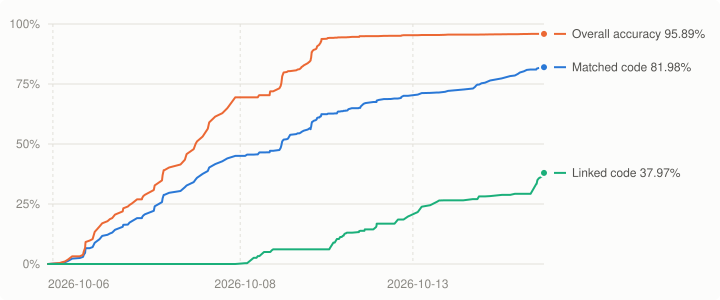

# Bakugan: Battle Brawlers (DS) decompilation

A work-in-progress matching decompilation of *Bakugan: Battle Brawlers* for the Nintendo DS. The C++ in this
repository is written by hand so that, built with the original compiler, it reproduces the game's code byte for byte.

**No game content is included.** The repository holds no ROM, no assets and no disassembly. To build, you need your
own dump of the game; see [INSTALL.md](INSTALL.md).

| Version | Game code | SHA-1 |
| --- | --- | --- |
| USA | `B6RE` | `dab7df53468533382d39631b488c491c7d1b78ca` |

## Progress
<!-- progress:start -->

| Measure | Progress |
|---|---|
| Matched code | 66.90% (844,996 / 1,263,096 bytes) |
| Linked code (complete units) | 13.82% (174,580 bytes) |
| Overall accuracy (fuzzy) | 94.92% |
| Matched functions | 3,910 / 4,520 |

_Last updated 2026-10-09. Full history: [`progress/history.csv`](progress/history.csv)._
<!-- progress:end -->

## Documentation
- [INSTALL.md](INSTALL.md): setting up and building
- [CONTRIBUTING.md](CONTRIBUTING.md): repository layout, naming and workflow
- [docs/compiler.md](docs/compiler.md): how the compiler and flags were identified
- [docs/decompiling.md](docs/decompiling.md): source patterns that matter for matching

Built with [ds-decomp](https://github.com/AetiasHax/ds-decomp), Metrowerks CodeWarrior for DS run through
[wibo](https://github.com/decompals/wibo), and [objdiff](https://github.com/encounter/objdiff).
